# Issue Queue Sequencing Map
<!-- auto-maintained: run `uv run python scripts/issue_queue_sequencing_map.py --write` -->
**Última atualização:** 2026-11-13
**Total open issues:** 295

Snapshot via `gh issue list --state open` + GraphQL `issueType` (DataBoar/data-boar). **GitHub is the source of truth for milestone assignment** — this file mirrors that distribution; do not move issues in GitHub to match stale `.md`. Contagens ±5% por race com o GitHub.

- Cross-milestone re-alignment protocol (HITL): [#1522](https://github.com/DataBoar/data-boar/issues/1522) · [ADR-0061](../adr/ADR-0061-u-axis-issue-suborder-and-cross-milestone-gate.md)
- Hard-blocker helper (follow-up): [#1523](https://github.com/DataBoar/data-boar/issues/1523)

```mermaid
flowchart TD

subgraph ms_1["Milestone: v1.8.1 (3 open)"]
  n1["3 open in v1.8.1"]:::p3
end

subgraph ms_2["Milestone: v1.8.2 (75 open)"]
  n2["75 open in v1.8.2"]:::p3
end

subgraph ms_3["Milestone: v1.8.3 (36 open)"]
  n3["36 open in v1.8.3"]:::p3
end

subgraph ms_4["Milestone: v1.8.4 (58 open)"]
  n4["58 open in v1.8.4"]:::p3
end

subgraph ms_5["Milestone: v1.8.5 (76 open)"]
  n5["76 open in v1.8.5"]:::p3
end

subgraph ms_6["Milestone: backlog (11 open)"]
  n6["11 open in backlog"]:::p3
end

subgraph unassigned["No milestone (36 open)"]
  n7["36 open — unassigned"]:::p3
end

classDef p0 fill:#c0392b,color:#fff
classDef p1 fill:#e67e22,color:#fff
classDef p2 fill:#2980b9,color:#fff
classDef p3 fill:#7f8c8d,color:#fff
```

Governance Lens Phases A–E ([#539](https://github.com/DataBoar/data-boar/issues/539)–[#543](https://github.com/DataBoar/data-boar/issues/543)) are **closed** — the previous `NÃO INICIAR ANTES DE #539` edges are **not** live.

**v1.8.1** (GitHub, 3 open — do **not** treat as v1.8.0 work in `PLANS_TODO.md`): `#1446`, `#1447`, `#2238`.

**No milestone** (36 open): `#1846`, `#1855`, `#1920`, `#1927`, `#1928`, `#1929`, `#1930`, `#1931`, `#1932`, `#1949`, `#1951`, `#1966`, `#1988`, `#2009`, `#2022`, `#2032`, `#2039`, `#2080`, `#2081`, `#2099`, `#2100`, `#2101`, `#2127`, `#2134`, `#2136`, `#2137`, `#2156`, `#2176`, `#2183`, `#2188`, `#2189`, `#2224`, `#2230`, `#2235`, `#2239`, `#2240` — assign or defer via [#1522](https://github.com/DataBoar/data-boar/issues/1522) hygiene.

## Hard-blockers (active)

Open issues whose bodies still contain `**NÃO INICIAR ANTES DE #N**` (or equivalent) **and** whose blocker `#N` is still open:

| Blocker | Blocks (open) |
| --- | --- |
| — | **None** (scan of open issue bodies on 2026-11-13) |

### Stale `NÃO INICIAR` text (blocker already closed)

Not drawn as live edges — body cleanup is out of scope for this refresh:

| Open issue | Still cites | Blocker state |
| --- | --- | --- |
| — | — | — |

Removed from the previous map: `#539 → #540–#543` (all five closed); `#668` citing `#406` (`#668` now closed); `#406 → #606` (both closed); `#382` citing `#381` (both closed as of 2026-11-13).

## Contagens

| Dimensão | Distribuição |
| --- | --- |
| Total open | 295 |
| Issue Type Bug / Feature / Task / (none) | 18 / 79 / 134 / 64 |
| P0 / P1 / P2 / P3 / sem P (`[Pn]` in title, body, or labels) | 0 / 11 / 89 / 62 / 133 |
| Milestone v1.8.0 / v1.8.1 / v1.8.2 / v1.8.3 / v1.8.4 / v1.8.5 / backlog / (none) | 0 / 3 / 75 / 36 / 58 / 76 / 11 / 36 |
| U0 / U1 / U2 / U3 / sem U (`[Un]` in title or body) | 0 / 0 / 1 / 0 / 294 |
| Active hard-blocker edges | 0 |
