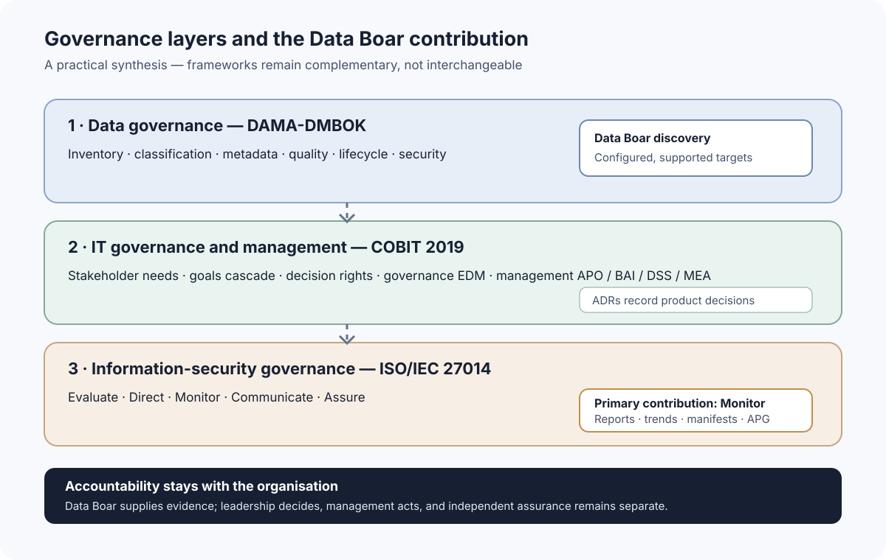
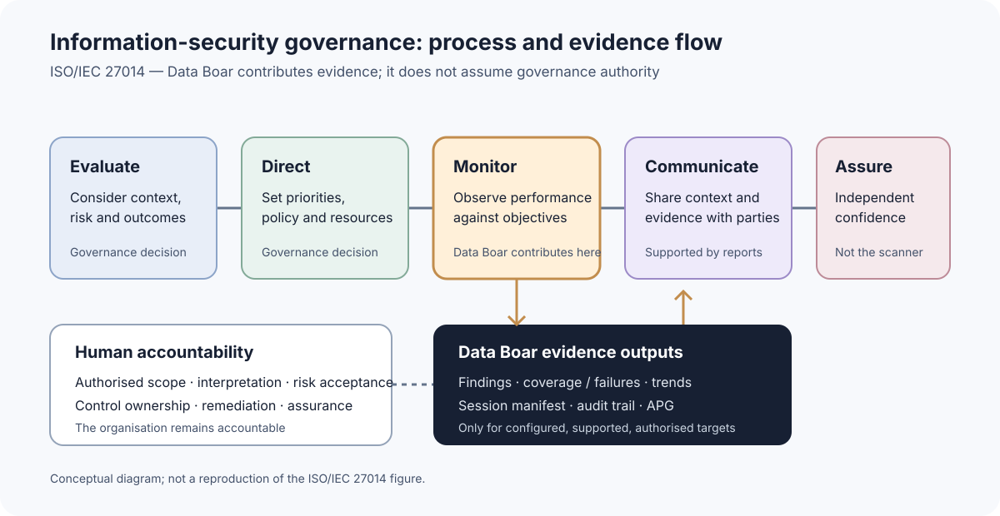

# Primer: information security governance (integrator KT)

**Português (Brasil):** [GOV_SI_PRIMER.pt_BR.md](GOV_SI_PRIMER.pt_BR.md)

**Audience:** CISOs, DPOs, IT-governance practitioners, compliance engineers, integrators, and students connecting data governance, IT governance, and information-security governance.

**Positioning ceiling:** Data Boar supplies technical inventory, discovery, and monitoring evidence. It does not set organisational risk appetite, approve controls, determine lawful basis, certify maturity, or provide independent assurance. See [ADR-0025](../adr/ADR-0025-compliance-positioning-evidence-inventory-not-legal-conclusion-engine.md).

**Related:** [Compliance methodology](../COMPLIANCE_METHODOLOGY.md), [Forensics and evidence primer](FORENSICS_AND_EVIDENCE_PRIMER.md), [Reports and compliance outputs](../REPORTS_AND_COMPLIANCE_OUTPUTS.md), [CISO pitch](../pitch/PITCH_CISO.md).

---

## 1. Governance is not operations

Information-security governance establishes how the organisation evaluates security needs, directs priorities and resources, monitors outcomes, communicates with stakeholders, and obtains assurance. Operational security management implements and runs the selected controls.

A policy, named owner, questionnaire response, or control declaration is evidence of an organisational statement; it is not, by itself, evidence that the control is operating correctly on every relevant system today.

The operator's PUC-Rio Sprint 1 study uses the 2026 Meu INSS/Dataprev incident to examine the distance between declared maturity and operational conditions. Its lesson for product design is not that self-assessment is useless, but that it must be complemented by observable, repeatable evidence from the data and systems in scope.

## 2. Three complementary layers

The following model is a practical synthesis used in the Sprint 1 study. The frameworks are complementary and should not be collapsed into one score:

| Layer | Main question | Framework contribution | Data Boar contribution |
| --- | --- | --- | --- |
| Data governance | What data exists, where is it, and how is it classified? | DAMA-DMBOK knowledge areas: governance, metadata, quality, architecture, storage and operations, security, integration and related disciplines | Discover and classify candidate personal/sensitive-data locations on configured, supported targets |
| IT governance and management | Who decides, why, and how are objectives translated into work? | COBIT 2019 goals cascade; governance objectives EDM and management domains APO, BAI, DSS, MEA | Provide evidence inputs for decisions; record product architecture decisions in ADRs |
| Information-security governance | How does leadership evaluate, direct, monitor, communicate, and assure security? | ISO/IEC 27014 governance processes and principles | Contribute technical monitoring evidence through scan results, session history, manifests, reports and remediation priorities |

The diagrams below are original explanatory material, not reproductions of standards figures.

## 3. Information-security governance processes

ISO/IEC 27014 provides a governance process model commonly expressed as Evaluate, Direct, Monitor, Communicate, and Assure. These are governance responsibilities, not five scanner features.

- **Evaluate:** governing bodies consider internal and external conditions, risks, obligations, and the effectiveness of current arrangements.
- **Direct:** leadership establishes priorities, policies, risk appetite, accountability, and resource allocation.
- **Monitor:** performance and outcomes are observed against the direction and objectives that were set.
- **Communicate:** information moves between governing bodies, management, operational teams, and relevant stakeholders.
- **Assure:** suitably independent activities provide confidence that governance and controls are effective.

Data Boar primarily contributes to **Monitor**. It can produce evidence that helps people evaluate and direct action, and its outputs can be communicated to stakeholders. It does not perform the board's Evaluate/Direct decisions and is not the independent Assure function.

## 4. Metrics are not automatically governance indicators

A technical metric becomes useful to governance only when interpreted against scope, business context, ownership, time, and a decision that someone is authorised to make.

| Operational measure | Governance question it can support | Required qualification |
| --- | --- | --- |
| Findings by severity and source | Where is observed exposure concentrated? | Detector scope, source type, and severity rationale |
| Targets attempted / complete / partial / failed | How much of the declared scope was actually observed? | Explicit denominator, exclusions, and terminal state |
| Session-over-session trend | Is observed exposure changing? | Comparable target set and scan conditions |
| Remediation priority and status | Which actions need management attention? | Owner, due date, decision status, and closure evidence must be supplied or integrated |
| Scan duration / failures | Is the monitoring process operationally reliable? | Runtime conditions and failure reasons |

Do not present raw finding counts as a complete risk picture. Do not present zero findings as zero exposure when coverage is partial, unavailable, sampled, or otherwise constrained. Do not turn technical indicators into a legal adequacy grade without a separate, defensible method and explicit human ownership.

## 5. Evidence flow and accountability

1. The organisation defines and authorises the scope.
2. Data Boar scans only configured targets for which a supported, authorised read-only path exists.
3. The session records findings, failures, limitations, and available integrity metadata.
4. Reports make the observation boundary visible, including what was not scanned and why.
5. The accountable owner interprets the evidence, decides priorities, and assigns remediation.
6. A later scan provides a comparable observation; the organisation evaluates whether the intended change is visible.

This is a monitoring and feedback loop, not an autonomous compliance decision. The accountable organisation retains responsibility for scope, interpretation, risk acceptance, control operation, and remediation.

## 6. What the product can and cannot claim

| Data Boar can support | Data Boar must not claim from discovery alone |
| --- | --- |
| Technical inventory of configured and successfully observed sources | Complete inventory of every asset in the organisation |
| Evidence of detected patterns and their technical context | Proof that a system is compromised or that an attack occurred |
| Session-bound reports, manifests, and integrity signals | Automatic legal admissibility or replacement of an expert report |
| Coverage and execution limitations, when instrumented and reported | Absence of risk when a source was inaccessible or not scanned |
| Prioritised technical review suggestions | Determination of lawful basis, purpose, retention, or compliance status |

For forensic handling, see [FORENSICS_AND_EVIDENCE_PRIMER.md](FORENSICS_AND_EVIDENCE_PRIMER.md). For report semantics and current output status, see [REPORTS_AND_COMPLIANCE_OUTPUTS.md](../REPORTS_AND_COMPLIANCE_OUTPUTS.md).

## 7. Academic and normative references

- PUC-Rio. *Governança de TI*, Aulas 1 e 3. Especialização em Compliance de Cibersegurança e Proteção de Dados, Sprint 1 (2026).
- PUC-Rio. *Análise Forense de Cibercrime e Investigação de Incidentes*, Aulas 1 e 2. Especialização em Compliance de Cibersegurança e Proteção de Dados, Sprint 1 (2026).
- DAMA International. *DAMA-DMBOK: Data Management Body of Knowledge*, 2nd edition.
- ISACA. *COBIT 2019 Framework: Governance and Management Objectives*.
- ISO/IEC 27014:2020. *Information security, cybersecurity and privacy protection — Governance of information security*. https://www.iso.org/standard/74046.html
- ISO/IEC 27037:2012. *Guidelines for identification, collection, acquisition and preservation of digital evidence*. https://www.iso.org/standard/44381.html

This primer is an original synthesis for product and learning context. Consult the applicable standards and qualified professionals for authoritative interpretation.
