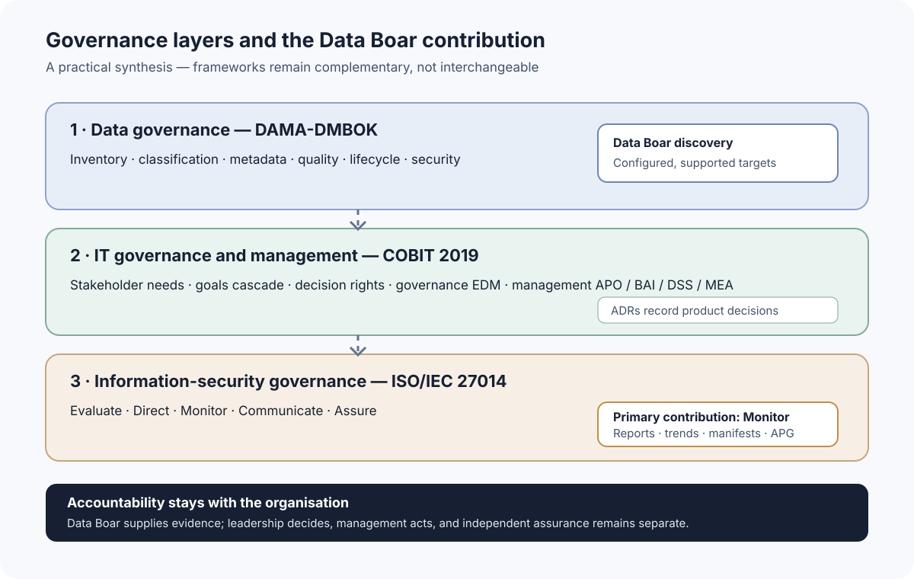
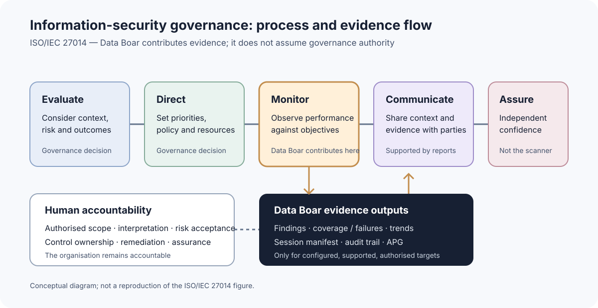

# Primer: governança de segurança da informação (KT para integradores)

**English:** [GOV_SI_PRIMER.md](GOV_SI_PRIMER.md)

**Público:** CISOs, DPOs, profissionais de governança de TI, engenharia de compliance, integradores e estudantes que conectam governança de dados, governança de TI e governança de segurança da informação.

**Limite de posicionamento:** o Data Boar fornece inventário técnico, descoberta e evidência para monitoramento. Não define apetite a risco organizacional, aprova controles, determina base legal, certifica maturidade nem executa asseguração independente. Consulte [ADR-0025](../adr/ADR-0025-compliance-positioning-evidence-inventory-not-legal-conclusion-engine.md).

**Relacionados:** [Metodologia de compliance](../COMPLIANCE_METHODOLOGY.pt_BR.md), [Primer de forense e evidências](FORENSICS_AND_EVIDENCE_PRIMER.pt_BR.md), [Relatórios e saídas de compliance](../REPORTS_AND_COMPLIANCE_OUTPUTS.pt_BR.md), [Pitch CISO](../pitch/PITCH_CISO.pt_BR.md).

---

## 1. Governança não é operação

A governança de segurança da informação estabelece como a organização avalia necessidades de segurança, direciona prioridades e recursos, monitora resultados, comunica-se com as partes interessadas e obtém asseguração. A gestão operacional de segurança implementa e opera os controles selecionados.

Uma política, um responsável nomeado, uma resposta a questionário ou uma declaração de controle evidenciam uma afirmação organizacional; isoladamente, não demonstram que o controle esteja operando corretamente em todos os sistemas relevantes hoje.

O estudo da Sprint 1 da PUC-Rio usa o incidente do ecossistema Meu INSS/Dataprev em 2026 para examinar a distância entre maturidade declarada e condições operacionais. A lição para o desenho do produto não é que a autoavaliação seja inútil, mas que ela precisa ser complementada por evidências observáveis e repetíveis dos dados e sistemas dentro do escopo.

## 2. Três camadas complementares

O modelo abaixo é uma síntese prática usada no estudo da Sprint 1. Os frameworks são complementares e não devem ser reduzidos a uma única pontuação:

| Camada | Pergunta principal | Contribuição do framework | Contribuição do Data Boar |
| --- | --- | --- | --- |
| Governança de dados | Que dados existem, onde estão e como são classificados? | Áreas de conhecimento do DAMA-DMBOK: governança, metadados, qualidade, arquitetura, armazenamento e operações, segurança, integração e disciplinas relacionadas | Descobrir e classificar possíveis locais de dados pessoais/sensíveis em alvos configurados e suportados |
| Governança e gestão de TI | Quem decide, por quê e como os objetivos viram trabalho? | Cascata de objetivos do COBIT 2019; objetivos de governança EDM e domínios de gestão APO, BAI, DSS e MEA | Fornecer insumos de evidência para decisões; registrar decisões de arquitetura do produto em ADRs |
| Governança de segurança da informação | Como a liderança avalia, dirige, monitora, comunica e assegura a segurança? | Processos e princípios de governança da ISO/IEC 27014 | Contribuir com evidências técnicas de monitoramento por meio de achados, histórico de sessões, manifestos, relatórios e prioridades de revisão |

Os diagramas abaixo são material explicativo original, não reproduções de figuras dos padrões.

## 3. Processos de governança da segurança da informação

A ISO/IEC 27014 apresenta um modelo de processos de governança frequentemente expresso como Avaliar, Dirigir, Monitorar, Comunicar e Assegurar. São responsabilidades de governança, não cinco funcionalidades de um scanner.

- **Avaliar:** instâncias de governança consideram condições internas e externas, riscos, obrigações e eficácia dos arranjos atuais.
- **Dirigir:** a liderança estabelece prioridades, políticas, apetite a risco, responsabilidades e alocação de recursos.
- **Monitorar:** desempenho e resultados são observados em relação à direção e aos objetivos definidos.
- **Comunicar:** informações circulam entre instâncias de governança, gestão, equipes operacionais e partes interessadas relevantes.
- **Assegurar:** atividades suficientemente independentes fornecem confiança sobre a eficácia da governança e dos controles.

O Data Boar contribui principalmente para **Monitorar**. Pode produzir evidências que ajudem pessoas a avaliar e direcionar ações, e suas saídas podem ser comunicadas às partes interessadas. Não executa as decisões de Avaliar/Dirigir do conselho nem substitui a função independente de Assegurar.

## 4. Métrica não se torna indicador de governança automaticamente

Uma métrica técnica só se torna útil à governança quando interpretada em relação ao escopo, contexto de negócio, responsabilidade, período e decisão que alguém tem autoridade para tomar.

| Medida operacional | Pergunta de governança que pode apoiar | Qualificação necessária |
| --- | --- | --- |
| Achados por severidade e fonte | Onde está concentrada a exposição observada? | Escopo do detector, tipo de fonte e justificativa da severidade |
| Alvos tentados / completos / parciais / falhos | Quanto do escopo declarado foi efetivamente observado? | Denominador explícito, exclusões e estado terminal |
| Tendência entre sessões | A exposição observada está mudando? | Conjunto de alvos e condições de varredura comparáveis |
| Prioridade e estado de remediação | Quais ações exigem atenção da gestão? | Responsável, prazo, estado da decisão e evidência de fechamento precisam ser fornecidos ou integrados |
| Duração / falhas de varredura | O processo de monitoramento é operacionalmente confiável? | Condições de execução e motivos das falhas |

Não apresente contagens brutas de achados como visão completa de risco. Não apresente zero achados como zero exposição quando a cobertura for parcial, indisponível, amostrada ou limitada de outra forma. Não converta indicadores técnicos em nota de adequação legal sem método próprio, defensável e responsabilidade humana explícita.

## 5. Fluxo de evidência e accountability

1. A organização define e autoriza o escopo.
2. O Data Boar varre apenas alvos configurados para os quais exista um caminho suportado, autorizado e somente leitura.
3. A sessão registra achados, falhas, limitações e metadados de integridade disponíveis.
4. Os relatórios tornam visível a fronteira de observação, inclusive o que não foi varrido e por quê.
5. O responsável interpreta as evidências, decide prioridades e atribui a remediação.
6. Uma varredura posterior fornece uma observação comparável; a organização avalia se a mudança pretendida é visível.

Este é um ciclo de monitoramento e feedback, não uma decisão autônoma de compliance. A organização continua responsável pelo escopo, interpretação, aceitação de risco, operação dos controles e remediação.

## 6. O que o produto pode e não pode afirmar

| O Data Boar pode apoiar | O Data Boar não deve afirmar apenas com base na descoberta |
| --- | --- |
| Inventário técnico de fontes configuradas e efetivamente observadas | Inventário completo de todos os ativos da organização |
| Evidência de padrões detectados e seu contexto técnico | Prova de comprometimento de um sistema ou de ocorrência de um ataque |
| Relatórios, manifestos e sinais de integridade vinculados à sessão | Admissibilidade jurídica automática ou substituição de laudo pericial |
| Cobertura e limitações de execução, quando instrumentadas e reportadas | Ausência de risco quando uma fonte estava inacessível ou não foi varrida |
| Sugestões priorizadas de revisão técnica | Determinação de base legal, finalidade, retenção ou status de conformidade |

Para tratamento forense, consulte [FORENSICS_AND_EVIDENCE_PRIMER.pt_BR.md](FORENSICS_AND_EVIDENCE_PRIMER.pt_BR.md). Para semântica e estado atual das saídas, consulte [REPORTS_AND_COMPLIANCE_OUTPUTS.pt_BR.md](../REPORTS_AND_COMPLIANCE_OUTPUTS.pt_BR.md).

## 7. Referências acadêmicas e normativas

- PUC-Rio. *Governança de TI*, Aulas 1 e 3. Especialização em Compliance de Cibersegurança e Proteção de Dados, Sprint 1 (2026).
- PUC-Rio. *Análise Forense de Cibercrime e Investigação de Incidentes*, Aulas 1 e 2. Especialização em Compliance de Cibersegurança e Proteção de Dados, Sprint 1 (2026).
- DAMA International. *DAMA-DMBOK: Data Management Body of Knowledge*, 2ª edição.
- ISACA. *COBIT 2019 Framework: Governance and Management Objectives*.
- ISO/IEC 27014:2020. *Information security, cybersecurity and privacy protection — Governance of information security*. https://www.iso.org/standard/74046.html
- ISO/IEC 27037:2012. *Guidelines for identification, collection, acquisition and preservation of digital evidence*. https://www.iso.org/standard/44381.html

Este primer é uma síntese original para contexto de produto e aprendizagem. Para interpretação normativa oficial, consulte os padrões aplicáveis e profissionais qualificados.
